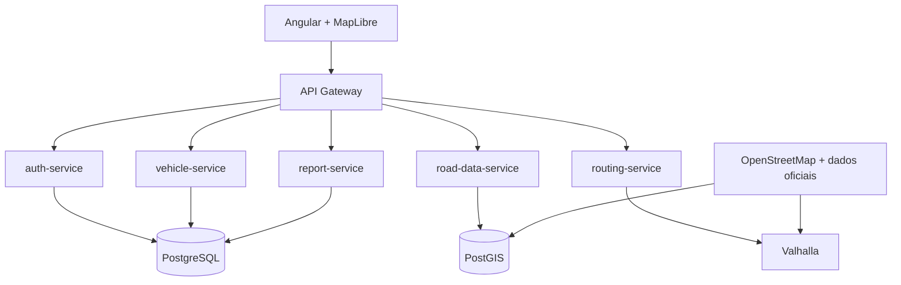

# VãoLivre

> Roteirização inteligente para caminhoneiros: rotas que respeitam as medidas e o peso do seu caminhão.


## Sobre o projeto

Aplicativos de navegação comuns calculam rotas pensando em carros. Para um caminhão, isso pode significar pontes baixas, ruas estreitas, limites de peso e restrições urbanas que não aparecem no mapa.

O **VãoLivre** é uma plataforma web que calcula rotas considerando o **perfil do veículo** (altura, largura, comprimento, peso e eixos) e mantém uma **base colaborativa de restrições viárias** no Brasil, alimentada por dados abertos, fontes oficiais e reports dos próprios motoristas.

> Este é um projeto de portfólio, construído para praticar arquitetura de microsserviços, boas práticas de código, testes e documentação.

## Funcionalidades planejadas

- [ ] Cadastro e login de usuários
- [ ] Cadastro de perfis de caminhão (dimensões, peso, eixos)
- [ ] Cálculo de rota considerando o perfil do caminhão
- [ ] Mapa interativo com a rota desenhada
- [ ] Reports de restrições feitos pelos motoristas (ponte baixa, via interditada)
- [ ] Ingestão de dados do OpenStreetMap e de fontes oficiais
- [ ] Validação dos reports por votação da comunidade

## Arquitetura



| Serviço | Responsabilidade |
|---|---|
| `auth-service` | Autenticação e autorização (JWT) |
| `vehicle-service` | Perfis de caminhão do usuário |
| `routing-service` | Cálculo de rotas usando o Valhalla |
| `road-data-service` | Ingestão e tratamento de dados viários |
| `report-service` | Reports e validação colaborativa |

## Tecnologias

- **Back-end:** Java 17, Spring Boot
- **Front-end:** Angular, MapLibre GL JS
- **Banco de dados:** PostgreSQL + PostGIS
- **Motor de rotas:** Valhalla (perfil de caminhão)
- **Infraestrutura:** Docker, Docker Compose
- **Qualidade:** JUnit, Testcontainers, GitHub Actions

## Estrutura do repositório

```
vao-livre/
├── frontend/          # Angular
├── gateway/           # API Gateway
├── services/          # Microsserviços Java
├── infra/             # Valhalla, scripts do banco
├── docs/              # Arquitetura, ADRs, diário de aprendizado
└── docker-compose.yml
```

## Como rodar

> Em construção. Os passos abaixo serão atualizados conforme o projeto evolui.

**Pré-requisitos:** JDK 17, Docker e Docker Compose, Git.

```bash
git clone https://github.com/SEU-USUARIO/vao-livre.git
cd vao-livre
docker compose up
```

## Roadmap

- **Fase 1 (MVP):** rota de caminhão em uma região, com cadastro de veículo e interface web
- **Fase 2:** reports de motoristas e camada própria de restrições
- **Fase 3:** dados oficiais, cache, observabilidade e mensageria

## Documentação

- Decisões técnicas: [`docs/adr`](docs/adr)
- Diário de aprendizado: [`docs/learning-log.md`](docs/learning-log.md)

## Autor

Pedro H. Marcelino
[LinkedIn](https://www.linkedin.com/in/pedro-marcelino-16a398175/) · [GitHub](https://github.com/pedroMarcelino)
